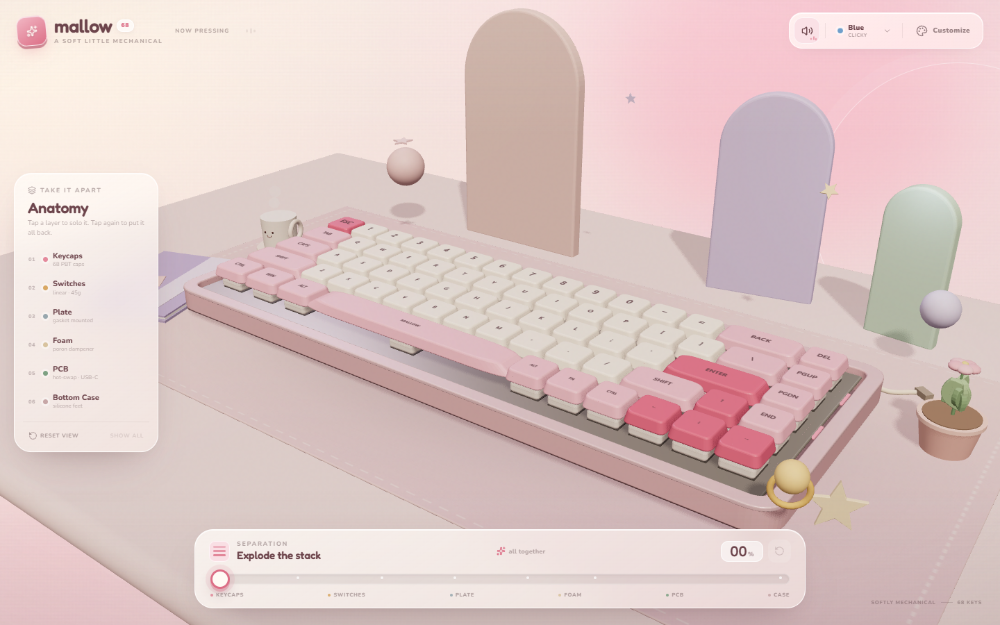

# Mallow 68

A playful, pastel 3D mechanical keyboard you can take apart layer by layer — and a
tiny Windows companion that brings its switch sounds to every app on your computer.



Built with **React 19**, **React Three Fiber**, **Drei**, **GSAP**, **Framer Motion**,
and **Zustand**. The tray companion is a small C# / .NET Framework app with a
global keyboard hook and a localhost bridge.

## Run the website

```bash
npm install
npm run dev
```

For a production build:

```bash
npm run build
npm run preview
```

## Switch sounds

The sound picker in the top-right has five profiles:

| Profile | Character |
| --- | --- |
| **Red** | smooth linear, deep thock, no click |
| **Brown** | tactile bump, warm mid thock |
| **Blue** | crisp click with a small high ping |
| **Thock** | low, rounded, mellow |
| **Clack** | tight, bright, snappy |

Browser audio works while the tab is focused. Browsers intentionally cannot capture
keyboard input from other applications.

## System-wide typing sounds

For sounds while typing in Word, Discord, a game, or anywhere else, download the
**MallowKeys** tray companion:

- In the website: open the sound picker and choose **Get app**.
- In this repository: [`public/downloads/MallowKeys.zip`](public/downloads/MallowKeys.zip).

Extract the ZIP, keep `MallowKeys.exe` and the `sounds` folder together, and run the
EXE. It lives in the Windows system tray. Right-click the pink keycap icon to switch
between Red, Brown, Blue, Thock and Clack, mute, test, or enable **Start with Windows**.

When MallowKeys is running, the website detects it through a local bridge at
`127.0.0.1:43783` and automatically hands sound playback to the tray app so the two do
not double up. The website can then also change the tray app's selected switch.

MallowKeys:

- never records which keys you press;
- never saves typed text;
- never sends keystrokes over the network;
- only uses the local bridge to exchange sound settings.

The full source is in [`tools/MallowKeys`](tools/MallowKeys). Rebuild the portable
package with:

```bat
tools\MallowKeys\build.bat
```

Windows may show a SmartScreen warning because the companion is new and unsigned.
Choose **More info → Run anyway** if you trust the source. No administrator rights are
required. Some elevated applications may not send keys to a normal-privilege app owing
to Windows security boundaries. If a browser blocks the localhost bridge (for example
on some HTTPS deployments), the tray menu still works independently.

## What's inside the scene

- **68-key custom layout** with instanced keycaps, switches, plate cut-outs, foam cut-outs,
  and PCB sockets.
- **Explode slider (0–100%)** — keycaps float up, switches lift, then plate, foam, PCB, and
  finally the bottom case slides forward. Every layer is spring-driven with a little
  overshoot.
- **Layer isolation** — use the Anatomy panel or click a visible part. Everything else
  fades to 15% opacity.
- **Switch peek** — hover an exposed switch (or solo Switches) to lift its cap and split it
  into stem, spring, and housings.
- **Physical keyboard input** — mapped 68-key layout with press animation and sound.
- **Live customizer** — six keycap themes and six case colors, animated into the scene and
  saved in `localStorage`.
- **Touch and mobile layout** — responsive camera, native range input, horizontal layer
  strip, and a bottom-sheet customizer.
- **No external visual assets** — decals, legends, materials, and shadows are generated
  locally. The companion uses locally generated WAV variants.

## Controls

| Action | Control |
| --- | --- |
| Orbit | Drag on empty scene space |
| Explode | Bottom slider, or the reset button |
| Isolate a layer | Anatomy panel, or click a part in the scene |
| Change switch sound | Sound pill in the top bar |
| Customize | Palette button, top right |
| Play a key | Press your keyboard, or tap a keycap |
| Switch peek | Hover switches once they're exposed |
| System-wide sound | Run MallowKeys.exe from the downloaded ZIP |

## Project layout

- `src/three/` — scene, desk props, instanced keyboard, springs, and material fading.
- `src/ui/` — top bar, sound picker, Anatomy panel, explode dock, customizer, and hints.
- `src/data.js` — the 68-key layout, themes, case colors, and exploded-layer choreography.
- `src/soundProfiles.js` — the five switch profiles.
- `src/audio.js` — the browser Web Audio synth.
- `src/desktopBridge.js` — detection and setting sync for MallowKeys.
- `tools/MallowKeys/` — the Windows tray companion source, sounds, and build script.
- `public/downloads/MallowKeys.zip` — the downloadable tray app.
